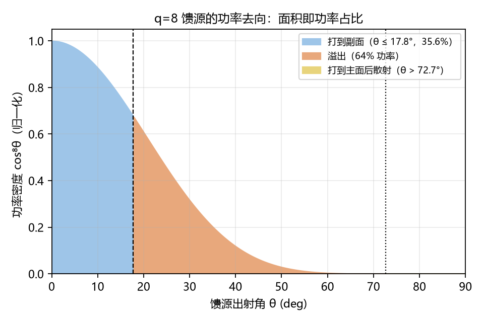
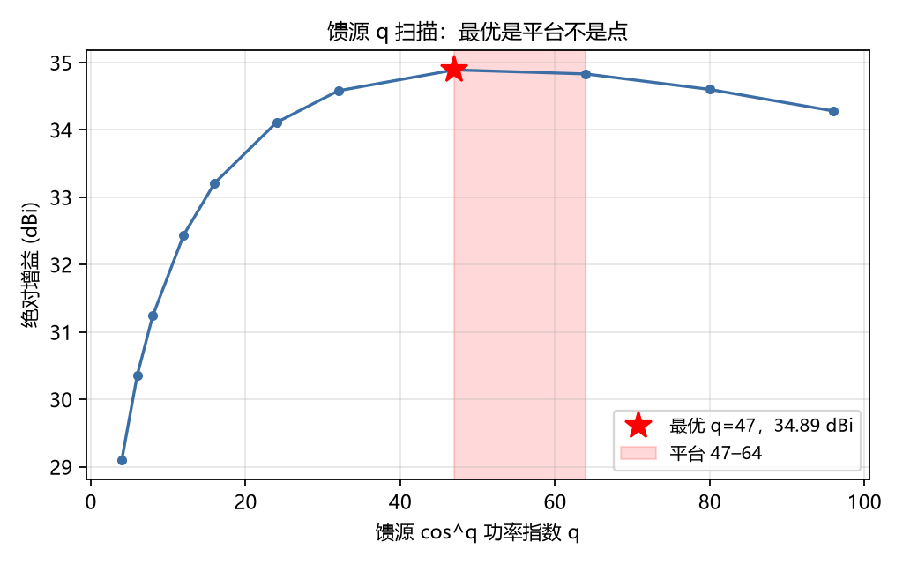

# 第 5 章 馈源与副面的联合设计

## 5.1 引论

第 4 章给出的效率预算显示，20λ 算例的绝对增益为 31.24 dBi，而理想均匀口径为 35.96 dBi。二者相差 4.72 dB。本章旨在分解这一差值，并说明其中的主项并非遮挡或锥削，而是馈源与副面之间的张角失配。

此项失配的发现过程值得记述：它并非由某项独立检验揭示，而是在增益预算被逐项拆解后才显现出来。

## 5.2 被归一化遮蔽的损失项

口径远场积分的归一化因子取 ∫A dA，即只对落到口径上的那部分功率求和。馈源辐射中未被副面接收的部分，自始至终不进入任何求和式。其后果是：所有相对量（增益损失、方向图对比）均正确，而绝对增益存在系统性缺失。

溢出的几何判据如下：馈源置于主面顶点时，副面对应的馈源张角仅为 0°–17.76°。以 cos^q 型功率方向图积分，溢出效率为

    η_spill = 1 − cos^(q+1)(θ_edge)                 (5-1)

取 q = 8、θ_edge = 17.76°，得 η_spill = 0.3557，即溢出功率占 64%。式 (5-1) 的解析结果与数值积分相差 1.4×10⁻⁶，可认为已充分校验。

## 5.3 溢出功率的归属

一个常见的疑问是：溢出功率同样向外辐射，为何全部计为损失？其依据在于方向性定义

    D = 4π U_max / P_rad                             (5-2)

式 (5-2) 中 P_rad 包含全部辐射功率。溢出部分落在 17.76°–90° 的大角度范围：其中 17.76°–72.65° 直接越过口径边界，72.65°–90° 落在主面上并依镜面反射散射至离轴约 46° 方向。两段均不贡献轴向的 U_max，故只能计入分母。

溢出功率的角度分布如图 5-1 所示，图中面积即功率占比。

此结论并非近似处理，而是方向性定义的直接推论。

## 5.4 馈源指数扫描

将馈源功率指数 q 自 4 扫描至 96，所得总增益如下表：

| q | 溢出发射损失 | 总效率 | 绝对增益 |
|---|---|---|---|
| 8 | −4.49 dB | 0.3372 | 31.24 dBi |
| 16 | −2.49 dB | 0.5299 | 33.21 dBi |
| 32 | −0.97 dB | 0.7267 | 34.58 dBi |
| 47 | −0.44 dB | 0.7815 | 34.89 dBi |
| 64 | −0.19 dB | 0.7713 | 34.84 dBi |
| 96 | −0.04 dB | 0.6790 | 34.28 dBi |

馈源指数扫描结果如图 5-2 所示。

其机理可表述为：q 增大使溢出减少，但同时加深边缘锥削、降低口径效率，二者在 q ≈ 50 附近取得平衡。

然而更具工程意义的是曲线的形状而非极值位置。q = 47 与 q = 64 的增益仅相差 0.05 dB，q = 32 至 q = 64 的整段区间内增幅不超过 0.3 dB。因此该极值应表述为平台而非单点，建议取值区间为 q ∈ [40, 70]，典型值 50。

若以单点最优形式表述（「最优 q = 47」），将不可避免地引出「何以恰为 47」的质疑；而 0.05 dB 的差异远小于模型不确定度，该质疑无法从数值层面予以回答。

相对原配置（q = 8），本项优化的净收益为 3.65 dB。

## 5.5 全波馈源对照

前述分析均以解析 cos^q 方向图为前提。为检验该前提的合理性，采用 openEMS 对一实际销钉馈电角锥喇叭进行全波仿真（WR-90 矩形波导加阶梯/斜面喇叭，工作频率 10 GHz），并将所得方向图拟合为等效 q 值。

| 模型 | 口径 | D_max | E 面锥削 @17.76° | H 面锥削 @17.76° |
|---|---|---|---|---|
| 销钉喇叭 | 80×60 mm | 13.21 dBi | −1.58 dB（q≈8.1） | −5.50 dB（q≈23） |
| 销钉喇叭 | 58×60 mm | 12.02 dBi | −1.37 dB（q≈6.8） | −2.99 dB（q≈11.7） |

其中一项结果值得注意：流水线原假设的 cos⁸ 方向图（17.76° 处 −1.70 dB）与实际喇叭 E 面（−1.58 dB）几乎重合，而 H 面相差 3.8 dB。该差异源于口径 x 向尺寸 80 mm（2.67λ）相对于副面张角过宽。

将全波方向图接入流水线后，E 面与 H 面所得绝对增益分别为 31.25 dBi 与 31.13 dBi，相差仅 0.12 dB。其原因与 5.2 节所述一致：遮挡与溢出在预算中占主导，口径效率对锥削变化不敏感。

该结果具有双重含义。其一，解析馈源替换为全波馈源对本文增益结论的影响不超过 0.12 dB，第 4 章数值不因更换模型而失效。其二，矩形喇叭的 E/H 面不对称是确实存在的（锥削差 3.8 dB），将导致主面方向图不对称，而流水线采用轴对称假设。此项须列入模型边界，见第 7 章。

## 5.6 本章小结

本章结论有三：

其一，原算例的馈源配置存在实质性错误，q = 8 时 64% 的功率溢出副面，代价为 4.49 dB；改取 q ≈ 50 可回收 3.65 dB。

其二，最优值为平台而非单点，应以区间形式表述。

其三，全波仿真验证了解析假设在 E 面上的合理性，同时揭示轴对称假设在 H 面上的局限（相差 3.8 dB）。

本章的价值不在于 34.89 dBi 这一数值本身，而在于识别出算例配置的错误并给出其修正代价。此项错误无法由单点验证发现，只能通过逐项拆解增益预算察觉。
