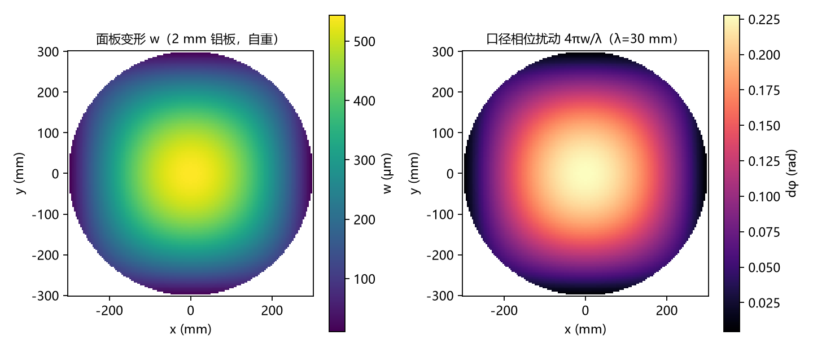
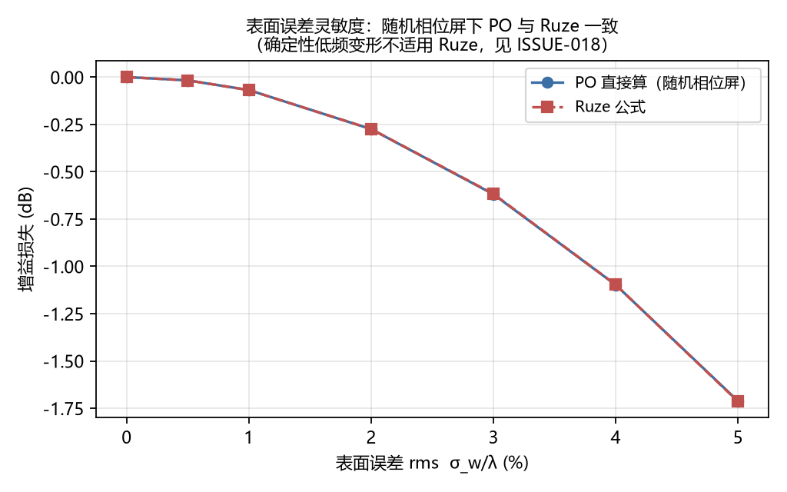
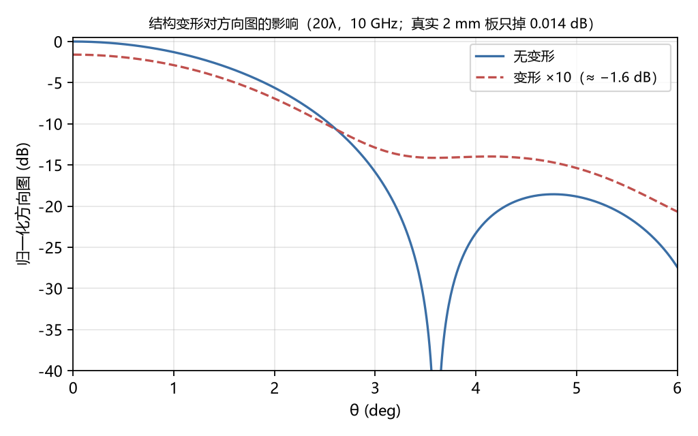

# 第 6 章 结构—电磁耦合

## 6.1 引论

反射面面板在自重、风压与温度作用下产生变形，变形改变口径相位分布，相位变化进而影响增益与方向图。

打通该链条需要三项要素：结构求解器、变形到相位的接口、可接受相位扰动的远场积分器。三者齐备之后，尚须回答一个更具约束性的问题——该效应的量级究竟如何。

本章的结论将表明，在 20λ 口径下该效应处于 0.01 dB 量级，因而本章的定位为灵敏度分析，而非性能预测。

## 6.2 结构求解：Kirchhoff 板与双泊松分解

面板可视为薄板。Kirchhoff 板方程为四阶形式

    ∇⁴w = q/D                                       (6-1)

其中 D = Et³/[12(1−ν²)] 为弯曲刚度。式 (6-1) 的求解需要 C¹ 连续单元，而 FEniCSx 未提供现成板壳单元。

可行途径是将式 (6-1) 分解为两个二阶方程（混合形式）：

    M = −D∇²w                                       (6-2)
    ∇²M = −q                                        (6-3)

式 (6-2) 与 (6-3) 均为泊松方程，C⁰ 拉格朗日单元即足以求解。

该近似存在一项明确的缺陷：简支边界条件应为 M_nn = 0（法向弯矩为零），而此处施加的是 M = 0（弯矩和为零）。板内满足 M = M_nn + M_ss，二者并不相等。其后果为使板偏刚、挠度偏小。偏差量级如下：

| 几何 | 中心挠度偏差 |
|---|---|
| 方板（边长 600 mm） | −5.4% |
| 圆板（直径 600 mm） | −26.6% |

该偏差不随网格加密而改善：方板网格自 40×40 加密至 80×80，偏差仅由 −5.57% 变为 −5.43%。因此此项属模型误差而非离散误差，论文中须按此定性，否则将面临关于网格收敛性的质疑。

鉴于圆板情形偏差达 −26.6%，不可接受，本章结构侧采用方形子板。实际反射面板普遍由方形子板拼接而成，该选择与实际构型相符。

## 6.3 变形到相位的转换

口径相位扰动由光程差确定：

    dφ = 2kw = 4πw/λ                                (6-4)

面板变形与口径相位分布如图 6-1 所示。

变形场以散点形式给出（板网格节点），须先插值至口径极坐标网格，再依式 (6-4) 计算相位。

链路有效性的检验方法为：将变形量依 1、5、10、20 倍放大，观察增益损失是否单调变化。

| 放大倍数 | 轴向场比 | 增益损失 |
|---|---|---|
| 1 | 0.99824 | −0.015 dB |
| 5 | 0.95651 | −0.386 dB |
| 10 | 0.83324 | −1.585 dB |
| 20 | 0.43712 | −7.188 dB |

结果单调，且 1 倍情形与解析挠度解给出的 −0.018 dB 相符（相差 0.003 dB，源于方板与圆板的几何差异）。据此可判定链路正确。

## 6.4 两种独立方法的交叉验证

解析解（圆板、简支、均布载荷）：

    w(r) = q/(64D)·(a²−r²)·[(5+ν)/(1+ν)·a² − r²]  (6-5)

对 600 mm 口径、2 mm 铝板、自重载荷 53 Pa，中心挠度为 533 μm，σ_w/λ = 0.0055，由 PO 直接积分得增益损失 −0.018 dB。

数值解（方板、FEniCSx）：中心挠度 543.5 μm，σ_w/λ = 0.0050，增益损失 −0.015 dB。

两种相互独立的方法给出同一量级，即 0.01 dB 级。该结论较之任一单点结果更为可靠。

## 6.5 Ruze 公式的适用边界

Ruze 公式给出

    G/G₀ = exp(−σ_φ²)                              (6-6)

本章中该式出现于两类不同场合，结论亦显著不同：

| 场合 | PO 直接计算 | Ruze 公式 | 偏差 |
|---|---|---|---|
| 随机相位屏（相关长度远小于口径） | — | — | < 1% |
| 圆板整体挠曲（低频、空间相关） | −0.018 dB | −0.021 dB | 15% |

差异的根源在于前提条件而非公式形式。式 (6-6) 的前提是相位误差随机分布且相关长度远小于口径；而圆板挠曲为低频确定性场，整片同向偏移，其对轴向场的抵消弱于随机场。

据此，本文对确定性变形一律采用 PO 直接积分，式 (6-6) 仅用于随机面板误差。

## 6.6 表面误差灵敏度

将表面误差自 0 扫描至 0.06λ，结果如下：

| σ_w/λ | 增益损失 | 第一副瓣电平 |
|---|---|---|
| 0.01 | −0.069 dB | −18.51 dB |
| 0.02 | −0.274 dB | −18.79 dB |
| 0.04 | −1.100 dB | −19.60 dB |
| 0.06 | −2.465 dB | −20.95 dB |

表面误差灵敏度曲线如图 6-2 所示。

反解得：0.5 dB 的增益损失要求 σ_w = 0.027λ，对应 10 GHz 下 0.81 mm，约为自重挠度的 8 倍。

此处另有一项反直觉的结论：随机表面误差使第一副瓣电平下降而非上升。其原因为主瓣能量被打散，紧邻主瓣的第一副瓣首先受到削弱。若欲论述副瓣抬升，须考察远角区平均旁瓣电平，属另一套评估方法。

变形放大 10 倍时的方向图对比如图 6-3 所示。

确定性变形的情形不同：第 6.3 节所述 10 倍放大算例中，副瓣电平确实自 −18 dB 升至 −14 dB。

## 6.7 本章小结

本章结论有三：

其一，结构至相位至远场的链路已打通，两种独立方法均给出 0.01 dB 级的结果。

其二，该量级不足以支撑「结构变形导致性能退化」的论述，故本章定位为灵敏度分析。

其三，板弯曲的 5.4% 偏差属模型误差（不随网格收敛），Ruze 公式不适用于确定性变形（偏差 15%），二者均须列入模型边界。

本章最易受到的一项质疑是：0.01 dB 有何意义？其回答为：本章给出的是公差要求。欲观察到 0.5 dB 的增益变化，面板公差须压缩至 0.81 mm 以内。此为设计输入，而非无效结果。
