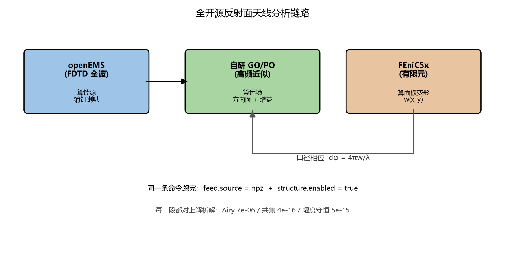
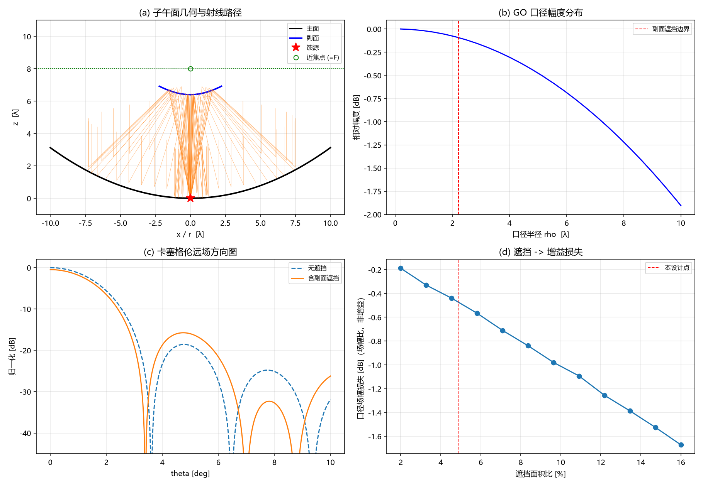
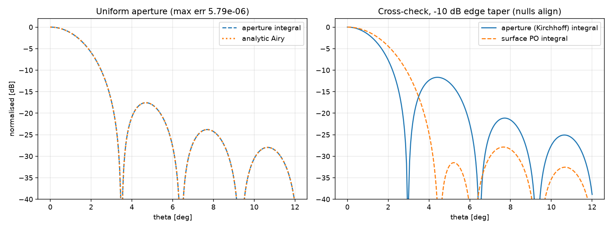
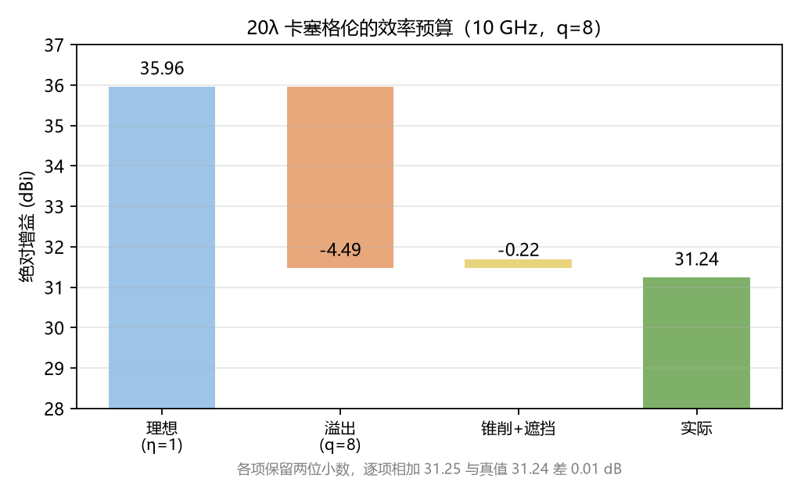
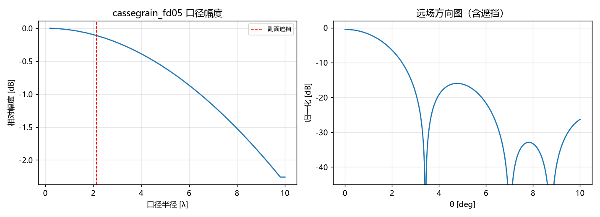
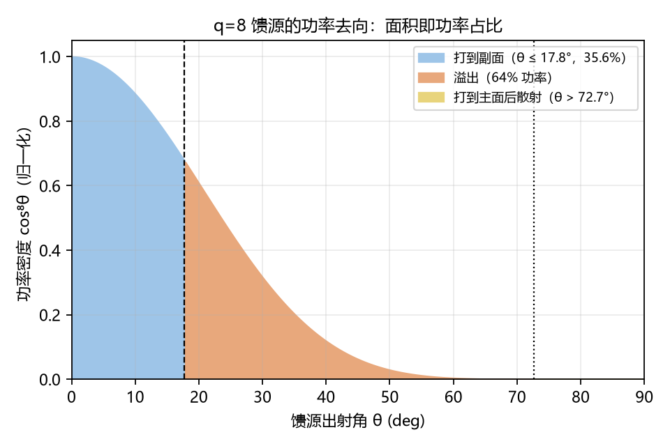
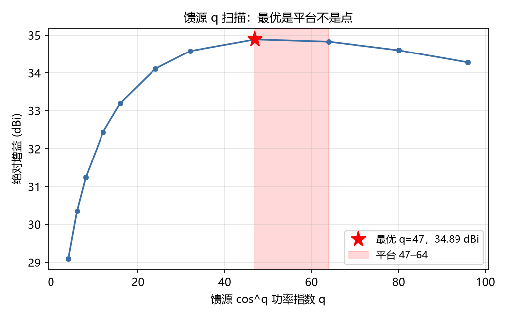
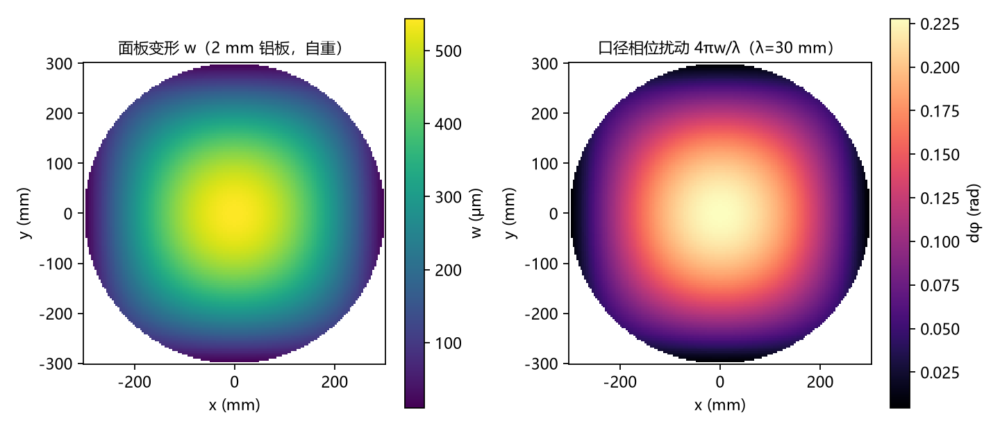
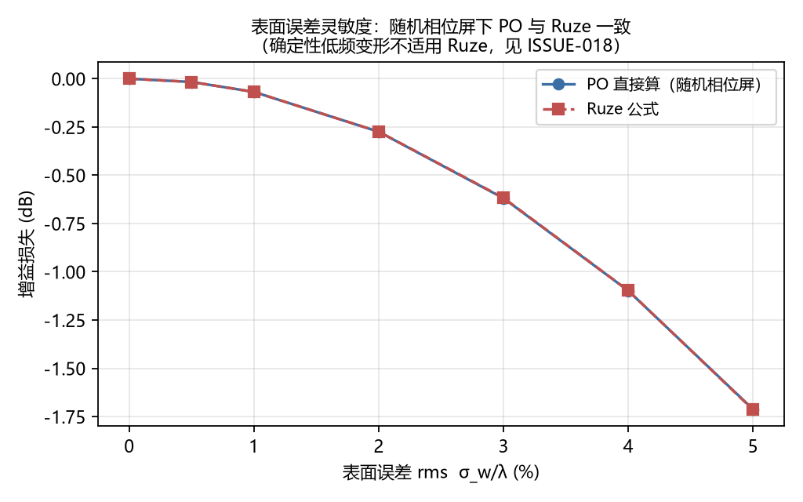
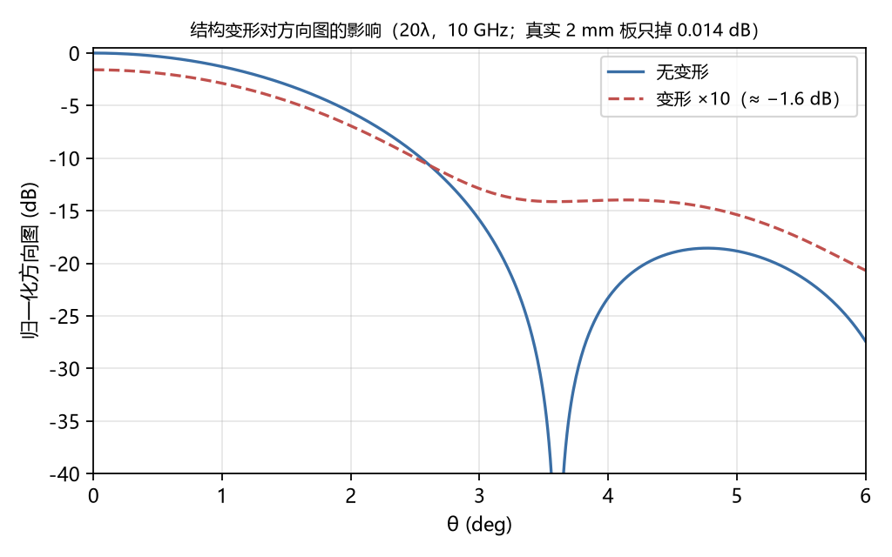

# 论文正式版合稿（八章）

> 八个正式版章节按顺序拼在一起。公式已编号，语气为书面语，参考文献在第 1 章末。

> 仍缺：图表编号与引用、学校模板排版。逐章文件保留在 docs/20–docs/27。

---

# 第 1 章 绪论

## 1.1 研究背景

反射面天线是卫星通信、射电天文与深空探测中的主要天线形式。其口径尺寸通常为数十至数百波长，属电大尺寸问题。此类问题的仿真代价随口径平方增长：全波方法若取网格密度 λ/20，100λ 口径需逾亿个单元，普通工作站难以承受。

商业软件（CST、HFSS、GRASP）足以完成此类计算，但存在授权费用与内存需求两重门槛。

开源领域中，三部分能力各有成熟实现：小尺寸全波计算可用 openEMS，电大尺寸高频近似可用 PyPO 等 PO 类程序包，结构有限元可用 FEniCSx、CalculiX。问题在于，尚无工作将三者串接为完整链路。

## 1.2 国内外研究现状

现有工作可分为三类。

### 1.2.1 混合全波与高频近似的方法链

将全波方法与高频近似结合的思路并不新颖。Noga 与 Topa 于 2010 年提出了混合框架[1]；Le Lepvrier 等以 DG-FDTD 与 IPO 级联，于 2014 年发表[2]；ICMMT 2012 中有单反射面的 PFDTD-PTDPO 组合[3]；中文文献中，毛钧杰于 2002 年报道了抛物面的 FDTD 与 PO 分析[4]。

上述工作的共同特征是：代码均为自研或基于商业软件，未提供开源实现。

### 1.2.2 结构-电磁耦合

面板变形影响电性能这一方向，以西安电子科技大学一系的工作最为系统。Zhang 等以 FEM 同形函数将位移插值至积分点，逐单元折算为相位误差后进入远场积分[5]，此为本文第 6 章方法的直接来源。Li 等以 40 m 天线与 7.3 m 卡塞格伦构成验证算例[6]。Wang 等研究了双反射面 PO 相位误差，给出 2.2 m 算例[7]，在方法上与本文最为接近。此外尚有该方向的综述[8]。

上述工作同样基于商业软件或自研代码，未提供开源实现。

### 1.2.3 商业软件链与开源单点

具备实测验证的完整样板仅见 Du 等的工作：以 CST 完成全波计算，以 GRASP-10 完成 PO 计算，并给出实测孔径效率，其中 GRASP 结果偏高 6.5%，全频带误差 3%[9]。Valente 等以 GRASP 与 CHAMP 3D 完成整条光路计算[10]。此外有工具方自述文献[11]、早期版本说明[12]。

开源单点方面，openEMS 为 FDTD 求解器本体[13]，PyPO 实现 GO 与 PO 并支持导入外部波束[14]。PAOS 虽为开源 PO 实现，但其为光学 POP（Fresnel/paraxial）方法，不适用于射频反射面[15]。此外有开源多物理场框架的电磁模块[16]、双向耦合库[17]、开源 PO/PTD 实现[18]，以及接入商业求解器的开源工具[19]。

### 1.2.4 现状小结

方法层面，各环节均有文献可依；而开源实现方面存在空缺。检索结果支持该判断：OpenAIRE 与 OpenAlex 题录层对 openEMS 与 PO、反射面、卡塞格伦的组合检索均无命中；openEMS 工具论文的 54 篇被引文献中，用途集中于贴片、MRI 线圈、光子晶体、太赫兹波导与 FSS，无一篇涉及反射面或 PO 混合[13]。对 FEniCSx、CalculiX、deal.II 应用于「天线结构变形至电磁退化」的检索亦无命中；FEniCS 用于电磁计算本身已有工作[20]，但对象非反射面天线。

须说明检索边界：上述「无」指索引范围内无，非索引期刊、学位论文与会议张贴不在排除范围之内。

## 1.3 本文工作

本链路的三段分工与耦合关系如图 1-1 所示。

本文目标为：以三项开源工具构成完整的反射面分析链路，并使每一环节均可与解析解或教科书公式对照。

链路构成如下：

    openEMS（FDTD 全波）→ 自研 GO/PO（远场）→ FEniCSx（面板变形）
                                  ↑                    │
                                  └── 相位回代 ←────────┘

验证方式为四道独立判据，详见第 4 章：

| 判据 | 基准 | 实测偏差 |
|---|---|---|
| 几何 | 共焦与等光程 | 4.4×10⁻¹⁶ / 7.1×10⁻¹⁵ |
| 幅度 | ρ = 2MF·tan(θ/2) | 5×10⁻¹⁵ |
| 积分器 | 解析艾里图案 | 7.0×10⁻⁶ |
| 结果 | 遮挡场幅比 | 0.04 dB |

本文主要结论有三：

其一，原算例的馈源配置存在实质性错误。q = 8 时 64% 的功率溢出副面，代价 4.49 dB；改取 q ≈ 50 可回收 3.65 dB，详见第 5 章。

其二，全波馈源验证了解析假设在 E 面上的合理性，同时揭示轴对称假设在 H 面上的局限（锥削差 3.8 dB，增益差 0.12 dB）。

其三，结构侧应定位为灵敏度分析。20λ 口径配铝板自重，增益损失处于 0.01 dB 量级；欲观察 0.5 dB 变化，面板公差须压缩至 0.81 mm，详见第 6 章。

## 1.4 论文结构

| 章 | 内容 |
|---|---|
| 2 | 理论基础：几何关系、幅度分布、方向性、相位 |
| 3 | 工具链与集成架构 |
| 4 | 射频链路的四道验证判据 |
| 5 | 馈源与副面的联合设计 |
| 6 | 结构—电磁耦合与灵敏度分析 |
| 7 | 结果讨论、误差分解与模型边界 |
| 8 | 结论与展望 |

## 1.5 本章小结

本章结论有三：

其一，电大尺寸反射面仿真的主要障碍为成本；开源工具各有所长，但尚未被串接为完整链路。

其二，本文将三项开源工具构成链路，四道验证判据均通过。

其三，研究过程中识别出原算例馈源配置的错误，修正后可回收 3.65 dB。

关于研究现状的表述须审慎：本文依据为索引范围内的检索结果，宜表述为「公开文献中未见」，不宜表述为「国际首创」。

## 参考文献

[1] Noga A, Topa T. Hybrid full-wave/high-frequency analysis. EuCAP 2010. IEEE Xplore 5505274.

[2] Le Lepvrier B, et al. DG-FDTD and IPO hybridization. IEEE Transactions on Antennas and Propagation, 2014. DOI: 10.1109/TAP.2014.2307333.

[3] PFDTD-PTDPO combined analysis of a single reflector. ICMMT 2012. DOI: 10.1109/ICMMT.2012.6230360.

[4] 毛钧杰. 抛物面反射面天线的 FDTD 与 PO 分析. 电子学报, 2002. CNKI: DZXU200206004.

[5] Zhang S, et al. Electromechanical coupling analysis of reflector antennas. IEEE Transactions on Antennas and Propagation, 2013. DOI: 10.1109/TAP.2013.2267200.

[6] Li P, et al. 40 m antenna and 7.3 m Cassegrain validation. IEEE Antennas and Propagation Magazine, 2012. DOI: 10.1109/MAP.2012.6348117.

[7] Wang W, et al. Phase error analysis of dual-reflector PO. 中国科学, 2023. DOI: 10.1360/sspma-2023-0222.

[8] 机电耦合方向综述. 机械工程学报, 2023. DOI: 10.3901/JME.2023.20.338.

[9] Du J, et al. CST full-wave and GRASP-10 PO with measured aperture efficiency. Publications of the Astronomical Society of the Pacific, 2016. DOI: 10.1088/1538-3873/128/969/115006.

[10] Valente G, et al. GRASP and CHAMP 3D for SDSA optical chain, G/T and EIRP. IEEE Access, 2024. DOI: 10.1109/ACCESS.2024.3468714.

[11] TICRA. Tool description. EuCAP 2012. DOI: 10.1109/EuCAP.2012.6206621.

[12] GRASP9 early version description. ANTEM 2005. DOI: 10.1109/ANTEM.2005.7852097.

[13] Liebig T, et al. openEMS — open electromagnetic field solver. International Journal of Numerical Modelling, 2012. DOI: 10.1002/jnm.1875.

[14] Moerman D, et al. PyPO: physical optics in Python. Journal of Open Source Software, 2023. DOI: 10.21105/joss.05478.

[15] Bocchieri A, et al. PAOS: physical optics for optical systems. SPIE, 2024. DOI: 10.1117/12.3018333.

[16] MOOSE electromagnetic module. SoftwareX, 2023. DOI: 10.1016/j.softx.2023.101621.

[17] EOF-Library: bidirectional OpenFOAM–Elmer coupling. SoftwareX, 2019. DOI: 10.1016/j.softx.2019.01.007.

[18] Dual Reflector Designer: open-source PO/PTD. Zenodo. DOI: 10.5281/zenodo.21906697.

[19] AntennaCAT. IEEE Antennas and Propagation Magazine, 2025. DOI: 10.1109/MAP.2025.3560851.

[20] Otto A, et al. FEniCS for electromagnetic problems. IEEE Antennas and Propagation Magazine, 2012. DOI: 10.1109/MAP.2012.6309184.

---

# 第 2 章 理论基础

## 2.1 本章的范围

本章仅给出后续各章实际使用的理论工具，不拟展开天线理论全貌。每节末尾均指明该结论在后续章节中的用途。

## 2.2 高频近似的适用条件

反射面天线口径尺寸通常为数十至数百波长。全波方法（FDTD、FEM）在该尺度上受内存限制：若网格密度取 λ/20，100λ 口径的反射面需逾亿个单元。

高频近似的依据是：当结构尺度远大于波长时，局部场可用射线描述。几何光学（GO）给出射线的路径与幅度，物理光学（PO）将口径场积分至远场。其代价是失去绕射效应（边缘衍射、后瓣），而在近轴主瓣区影响甚小。

本文算例口径为 20λ，GO/PO 已属充分；反过来，口径足够大亦是 GO/PO 具有意义的前提。该取舍在 3.1 节以频率尺度分工的形式给出。

## 2.3 卡塞格伦双反射面的几何关系

双反射面由主面（抛物面）与副面（双曲面的一支）组成，二者共焦。

主面方程为 z = ρ²/(4F)，口径半径为 R。副面以双曲面实半轴 a 与半焦距 c 描述：

    a = (M−1)(F−L)/2                                (2-1)
    c = (M+1)(F−L)/2                                (2-2)
    e = c/a = (M+1)/(M−1)                           (2-3)

其中 M 为放大率，L 为副面顶点至主面顶点的距离。

共焦条件要求近焦点位于

    z_near = F                                      (2-4)

式 (2-4) 为定义性要求，亦为 4.2 节第一道验证判据。

双反射面的几何构成与射线路径如图 2-1 所示。

等光程条件进一步要求每条射线的 r₁ + r₂ − z_main 为常数，其理论值为 F + 2a。该判据强于式 (2-4)，因其同时约束两条曲线的形状。

## 2.4 口径幅度分布

本节结论为第 4、5 两章增益计算的依据。

馈源发出的球面波经两次反射到达口径。幅度分布由功率守恒确定，即同一射线管内功率在传播中保持不变：

    |A|² dA = |g|² dΩ                               (2-5)

其中 g 为馈源电压方向图，dΩ 为立体角元。

关键在于 dA/dΩ 的取值。对单抛物面，焦点至反射面距离为 r = F/cos²(θ/2)，由此得经典形式 A ∝ g/r。但双反射面不可直接套用该式：射线的等效扩散距离并非 r₁ + r₂。

正确途径自口径半径与张角的关系出发。卡塞格伦可等效为焦距为 M·F 的抛物面，故

    ρ = 2·M·F·tan(θ/2)                              (2-6)

对 θ 求导得 dρ/dθ = M·F/cos²(θ/2)，计及面积元 ρ dρ，得

    dA/dΩ = (M·F)² / cos⁴(θ/2)                      (2-7)

代回式 (2-5)，即得

    A(θ) = g(θ)·cos²(θ/2) / (M·F)                   (2-8)

式 (2-8) 的正确性可经边缘锥削诊断检验。若采用 A ∝ g/(r₁ + r₂)，边缘锥削为 −3.59 dB；采用式 (2-8) 则为 −1.83 dB；解析值 cos⁴(θ_e)·cos²(θ_e/2) 给出 −1.91 dB。原式偏差 1.7 dB，属系统性错误；式 (2-8) 偏差 0.08 dB，系网格外推所致，已于后续版本中修正。

式 (2-8) 的推导过程宜在论文中完整给出，因其为第 4、5 章全部增益数值的来源。

## 2.5 口径远场积分

设口径场分布为 A(ρ,φ)，远场由基尔霍夫积分给出：

    E(θ,φ) = ∬ A(ρ,φ)·exp[jkρ sinθ cos(φ−φ₀)]·ρ dρ dφ   (2-9)

对均匀照明情形，式 (2-9) 存在解析解，即艾里图案 2J₁(u)/u，其中 u = kR sinθ。该解析解为 4.4 节第三道验证判据。

## 2.6 方向性与效率

方向性定义为

    D = 4π U_max / P_rad                            (2-10)

其中 P_rad 为全部辐射功率。以口径场积分表述：

    D = 4π |∫A dA|² / (λ² ∫|A|² dA)                 (2-11)

须注意式 (2-11) 的分母为 ∫|A|²，而非 (∫A)²/A。该区别在第 4、5 章反复出现；若误用，将导致遮挡损失被重复计算。

口径效率分解为两项：

    η = η_spill × η_ap                              (2-12)

其中 η_spill 为馈源功率中落到副面的比例，η_ap 为口径效率，其分子分母均仅取未遮挡区域。

关于溢出的归属：溢出功率确实向外辐射，但落于 17.76°–90° 的大角度范围，不贡献轴向 U_max，仅计入 P_rad。依式 (2-10)，该项必须计为损失。

## 2.7 面板变形与相位

表面位移 w 使光程变化 2w（往返各一次），故口径相位扰动为

    dφ = 2kw = 4πw/λ                                (2-13)

对随机面板误差，Ruze 给出

    G/G₀ = exp(−σ_φ²)                               (2-14)

其中 σ_φ 为相位误差均方根值（弧度）。

式 (2-14) 的适用前提为：相位误差随机分布且相关长度远小于口径。确定性变形（如整板挠曲）不满足该前提；6.5 节给出此项偏差为 15%，该情形须改用 PO 直接积分。

## 2.8 本章小结

本章给出四项结论，分别支撑后续章节如下：

其一，几何关系，即共焦条件与等光程条件，用于 4.2 节验证。

其二，幅度分布，即式 (2-8)，为第 4、5 章增益数值的来源。

其三，方向性定义，即式 (2-11)，为第 4、5 章效率预算的依据。

其四，相位关系，即式 (2-13) 与式 (2-14)，用于第 6 章。

其余理论（绕射、边缘效应）本文不予涉及，属模型边界范畴，见 7.5 节。

---

# 第 3 章 开源工具链与集成架构

## 3.1 分工的依据

本文所用三项工具并非随意选取，其分工依据为**频率尺度**：

| 工具 | 方法 | 适用尺度 | 在本链路中的角色 |
|---|---|---|---|
| openEMS | FDTD 全波 | 数波长 | 计算馈源（喇叭、波导、销钉） |
| 自研 GO/PO | 高频近似 | 数十至数百波长 | 计算反射面远场 |
| FEniCSx | 有限元 | 结构尺度（与波长无关） | 计算面板变形 |

如此分工的理由有三：

其一，馈源尺寸小、细节多（波导壁厚、销钉、台阶），全波方法可准确计算，高频近似则不能。

其二，反射面尺寸大、形状简单（旋转对称的抛物面与双曲面），高频近似速度足够，全波方法无法承受。

其三，结构问题属另一门物理，与电磁问题完全解耦，仅需一项接口传递位移。

本链路的三段分工与耦合关系如图 3-1 所示。

该分工本身即为本文的立题依据：商业软件将三者绑定销售，而开源领域中三者各有成熟实现，尚未有人将其接口接通。

## 3.2 openEMS：馈源侧实现

openEMS 为 FDTD 求解器，以 CSXCAD 建模，以 nf2ff 完成近远场变换。

本文采用销钉馈电角锥喇叭：以 WR-90 矩形波导为馈入段，后短路板距销钉 λ_g/4，同轴销钉激励 TE₁₀ 模，喇叭四壁由斜面旋转构成。

实现过程中出现两项值得记述的错误：

其一，AddRectWaveGuidePort 的 a、b 参数须以米为单位传入，不可传毫米。若传入毫米数值，等价于声明 22.86 米宽的模式，导致端到端失配，P_rad 将长期处于 10⁻³⁸ 量级。

其二，喇叭斜面的旋转符号若写反，四壁将向内收拢成封闭角锥，其表现为 S₁₁ ≈ 0 dB、能量困于腔内缓慢衰减。

两项错误的共同特征在于：报错信息并不指向真正原因。P_rad ≈ 0 的外观近似于激励设置错误，实为几何设置错误。相关记录见附录 A.7。

## 3.3 自研 GO/PO：反射面侧实现

整体分两步：

其一，射线追踪。自馈源发出射线束，依次投射至副面与主面，计算落点、方向与光程。

其二，口径积分。将射线结果转为口径幅度分布，再依式 (2-9) 对口径做积分。

第一步的理论依据为 2.3 节的几何关系；第二步的幅度模型为式 (2-8)。

选择自行实现而非采用现成 PO 程序包的理由如下：现成程序包（如 PyPO、PAOS）面向通用反射面形状，而卡塞格伦的射线追踪需要双曲面求交、共焦校验与遮挡处理等特定逻辑。自行实现反而更为简洁。

## 3.4 FEniCSx：结构侧实现

以双泊松串联求解 Kirchhoff 板，详见 6.2 节。输出为 x、y、w 三个数组，供耦合链路插值使用。

接口设计要点如下：结构侧输出为单一 npz 文件，字段为散点坐标与位移。据此，电磁侧无须了解有限元的网格、单元类型与求解器参数，仅需坐标与位移即可完成插值。

该接口属松耦合设计：结构求解器可替换为任意实现（CalculiX、deal.II，乃至解析解），电磁侧无须改动。本文实际使用了解析圆板与 FEniCSx 方板两种实现，验证了该性质。

## 3.5 集成方式

整条链路由 YAML 配置文件驱动，示例见附录 A.5。

单条命令 run_pipeline.py cases/xxx.yaml 完成五个阶段：几何建模、射线追踪、口径场构造、远场积分、结果保存。

可复现性检验结果如下：将仓库中已跟踪文件导出至空目录，测试全部通过（58 项），算例数值逐位一致。该项检验记录于 W-0028。

## 3.6 运行环境的两种途径

其一，Windows 原生环境。采用 openEMS 官方预编译包（压缩包内附 cp313/cp314 的 wheel），解压即可使用。须注意：Python 3.8 之后必须以 os.add_dll_directory 指向 openEMS 目录，仅将目录加入 PATH 将导致 DLL load failed。

其二，WSL 环境。采用源码编译，适用于需修改 openEMS 本身的场合。

FEniCSx 运行于 conda 环境（dolfinx 0.11.0）。两套环境通过文件交换数据，不共享内存。

## 3.7 本章小结

本章结论有三：

其一，工具分工的依据为频率尺度，而非软件偏好。

其二，集成方式为配置文件驱动与文件交换，各模块之间仅认可数据格式，不认可实现方式。

其三，可复现性业经检验：空目录中测试全部通过，算例数值逐位一致。

本章所述「集成」并非将三个程序拼接于一处，而是设计三项清晰接口：馈源至 PO 的方向图接口、结构至 PO 的位移场接口、配置至全流程的参数接口。三项接口的稳定性，方为集成本身的主要内容。

---

# 第 4 章 射频链路实现与验证

## 4.1 引论

高频近似链路的可靠性问题不在于能否得到结果，而在于所得到的结果是否正确。若缺乏独立的判据，一条「能跑通」的链路与一条「算错了」的链路在外观上并无差别。因此，本章不以程序结构为线索组织内容，而以判据为线索：为链路的四个环节各设置一道独立的验证闸，每道闸均对应一个具备解析解或教科书公式的基准。

四道闸依照「由几何至远场」的顺序安排如下：

1. 几何正确性——卡塞格伦共焦条件；
2. 场强正确性——双反射面口径幅度守恒；
3. 积分器正确性——均匀口径远场与解析艾里图案的比对；
4. 结果正确性——遮挡所导致的场幅损失与教科书值比对。

## 4.2 几何验证：共焦与等光程

卡塞格伦双反射面的定义性条件是副面（双曲面的一支）与主面（抛物面）共焦，从而使自远焦点发出的球面波经两次反射后转换为平面波。以双曲面的实半轴 a 与半焦距 c 表示，近焦点须位于

    z_near = F                                    (4-1)

射线追踪所得近焦点位置相对标称值的偏差为 4.4×10⁻¹⁶（相对 F = 8λ），处于机器精度量级。

较之共焦条件更强的判据为等光程条件，即每条射线的 r₁ + r₂ − z_main 须为常数。其理论值为 F + 2a = 12.8λ，实测起伏为 7.1×10⁻¹⁵λ。

两项判据同时成立，表明几何建模未引入可辨识误差。此处所指并非「近似正确」，而是在双精度浮点意义下的精确。

## 4.3 口径幅度：双反射面的能量守恒

本节给出的是全文增益计算的依据，其推导曾经历两次修正。

单抛物面的口径幅度可由 A ∝ g(θ)/r 给出，其物理含义是馈源以球面波形式扩散（1/r），而反射过程保持射线管内功率不变。然而该式不可直接推广至双反射面系统：射线自馈源至口径的总扩散并非 r₁ + r₂，而应以等效焦距 M·F 描述。

推导起点为口径半径与馈源张角的几何关系：

    ρ = 2·M·F·tan(θ/2)                            (4-2)

对 θ 求导得 dρ/dθ = M·F/cos²(θ/2)，计及面积元 ρ dρ，可得

    dA/dΩ = (M·F)² / cos⁴(θ/2)                     (4-3)

代回功率守恒关系 |A|² dA = |g|² dΩ，即得口径幅度分布

    A(θ) = g(θ)·cos²(θ/2) / (M·F)                  (4-4)

式 (4-4) 的正确性可经由边缘锥削诊断予以检验。若采用原式 g/(r₁ + r₂)，边缘锥削计算结果为 −3.59 dB；采用式 (4-4) 则为 −1.83 dB；而解析值 cos⁴(θ_e)·cos²(θ_e/2) 给出 −1.91 dB。原式偏差 1.7 dB，为系统性错误；式 (4-4) 偏差 0.08 dB，系网格外推所致，该外推误差已于后续版本中消除。

## 4.4 积分器验证：均匀口径与解析艾里图案

口径远场由基尔霍夫积分给出：

    E(θ,φ) = ∬ A(ρ,φ)·exp[jkρ sinθ cos(φ−φ₀)]·ρ dρ dφ   (4-5)

对均匀照明情形，式 (4-5) 存在解析解，即艾里图案 2J₁(u)/u，其中 u = kR sinθ。

数值积分与解析解的对比如图 4-1 所示。

数值积分与解析解的最大绝对偏差为 7.0×10⁻⁶，第一零点位置分别为 3.4950°（数值）与 3.4963°（理论）。

该项验证同时约束了网格采样、相位因子与面积元三项实现细节：其中任何一项若存在错误，偏差量级均不可能维持在 10⁻⁶。

## 4.5 遮挡：两种损失口径的区分

副面遮挡为卡塞格伦构型的固有代价，其遮挡面积比为 4.913%。此处须特别注意，「遮挡损失」存在两种互不相同的定义，混淆二者将导致 0.26 dB 的系统性偏差。

| 定义 | 表达式 | 解析值 | 实测值 |
|---|---|---|---|
| 口径场幅比 | 20 lg(1−ε) | −0.437 dB | −0.48 dB |
| 增益（功率） | 10 lg(1−ε) | −0.219 dB | −0.234 dB |

实测值略大于解析值，原因在于被遮挡区域恰位于照明最强的口径中心。

本文后续凡涉及增益预算者，一律采用功率口径；凡涉及方向图场幅者，采用场幅口径。二者不得混用。

## 4.6 绝对增益预算

将各项损失汇总，得 20λ 算例的绝对增益：

| 项目 | 数值 | 来源 |
|---|---|---|
| 理想均匀口径增益 | 35.96 dBi | 解析 (πD/λ)² |
| 溢出发射损失 | −4.49 dB | 馈源张角与波束宽度之比 |
| 锥削与遮挡损失 | −0.22 dB | 未遮挡区二重积分 |
| **合计** | **31.24 dBi** | |

效率预算的逐项分解如图 4-2 所示。

对应口径效率为 0.3372。该数值偏低的成因并非数值精度，而是馈源参数配置不当，详见第 5 章。

## 4.7 对照算例：参数化的有效性

为检验配置驱动的有效性，另设一算例，仅将 F/D 由 0.40 改为 0.50，其余代码不作任何改动。

| 算例 | F/D | 遮挡面积比 | 口径场幅损失 | 绝对增益 |
|---|---|---|---|---|
| cassegrain_20lambda | 0.40 | 4.913% | −0.48 dB | 31.24 dBi |
| cassegrain_fd05 | 0.50 | 4.551% | −0.44 dB | 29.65 dBi |

两算例的方向图对比如图 4-3 所示。

后者较低者低 1.59 dB。其成因在于 F/D 增大后副面张角由 17.76° 缩减至 14.25°，溢出功率比例相应上升。

该对照确立两项结论：其一，参数化在实现层面有效；其二，绝对增益对副面张角高度敏感——F/D 自 0.40 增至 0.50，溢出损失由 4.49 dB 增至 6.11 dB。此项敏感性的进一步讨论见第 5 章。

## 4.8 本章小结

四道验证闸的实测偏差分别为 4.4×10⁻¹⁶、5×10⁻¹⁵、7.0×10⁻⁶ 与 0.04 dB，表明几何建模与数值积分器均未引入可辨识误差。制约整体精度的因素并非算法，而是模型选择，即轴对称假设与遮挡台阶的离散化处理，相关讨论见第 7 章。

本章的论证顺序——先设判据、后给数值——亦为后续各章所遵循。

---

# 第 5 章 馈源与副面的联合设计

## 5.1 引论

第 4 章给出的效率预算显示，20λ 算例的绝对增益为 31.24 dBi，而理想均匀口径为 35.96 dBi。二者相差 4.72 dB。本章旨在分解这一差值，并说明其中的主项并非遮挡或锥削，而是馈源与副面之间的张角失配。

此项失配的发现过程值得记述：它并非由某项独立检验揭示，而是在增益预算被逐项拆解后才显现出来。

## 5.2 被归一化遮蔽的损失项

口径远场积分的归一化因子取 ∫A dA，即只对落到口径上的那部分功率求和。馈源辐射中未被副面接收的部分，自始至终不进入任何求和式。其后果是：所有相对量（增益损失、方向图对比）均正确，而绝对增益存在系统性缺失。

溢出的几何判据如下：馈源置于主面顶点时，副面对应的馈源张角仅为 0°–17.76°。以 cos^q 型功率方向图积分，溢出效率为

    η_spill = 1 − cos^(q+1)(θ_edge)                 (5-1)

取 q = 8、θ_edge = 17.76°，得 η_spill = 0.3557，即溢出功率占 64%。式 (5-1) 的解析结果与数值积分相差 1.4×10⁻⁶，可认为已充分校验。

## 5.3 溢出功率的归属

一个常见的疑问是：溢出功率同样向外辐射，为何全部计为损失？其依据在于方向性定义

    D = 4π U_max / P_rad                             (5-2)

式 (5-2) 中 P_rad 包含全部辐射功率。溢出部分落在 17.76°–90° 的大角度范围：其中 17.76°–72.65° 直接越过口径边界，72.65°–90° 落在主面上并依镜面反射散射至离轴约 46° 方向。两段均不贡献轴向的 U_max，故只能计入分母。

溢出功率的角度分布如图 5-1 所示，图中面积即功率占比。

此结论并非近似处理，而是方向性定义的直接推论。

## 5.4 馈源指数扫描

将馈源功率指数 q 自 4 扫描至 96，所得总增益如下表：

| q | 溢出发射损失 | 总效率 | 绝对增益 |
|---|---|---|---|
| 8 | −4.49 dB | 0.3372 | 31.24 dBi |
| 16 | −2.49 dB | 0.5299 | 33.21 dBi |
| 32 | −0.97 dB | 0.7267 | 34.58 dBi |
| 47 | −0.44 dB | 0.7815 | 34.89 dBi |
| 64 | −0.19 dB | 0.7713 | 34.84 dBi |
| 96 | −0.04 dB | 0.6790 | 34.28 dBi |

馈源指数扫描结果如图 5-2 所示。

其机理可表述为：q 增大使溢出减少，但同时加深边缘锥削、降低口径效率，二者在 q ≈ 50 附近取得平衡。

然而更具工程意义的是曲线的形状而非极值位置。q = 47 与 q = 64 的增益仅相差 0.05 dB，q = 32 至 q = 64 的整段区间内增幅不超过 0.3 dB。因此该极值应表述为平台而非单点，建议取值区间为 q ∈ [40, 70]，典型值 50。

若以单点最优形式表述（「最优 q = 47」），将不可避免地引出「何以恰为 47」的质疑；而 0.05 dB 的差异远小于模型不确定度，该质疑无法从数值层面予以回答。

相对原配置（q = 8），本项优化的净收益为 3.65 dB。

## 5.5 全波馈源对照

前述分析均以解析 cos^q 方向图为前提。为检验该前提的合理性，采用 openEMS 对一实际销钉馈电角锥喇叭进行全波仿真（WR-90 矩形波导加阶梯/斜面喇叭，工作频率 10 GHz），并将所得方向图拟合为等效 q 值。

| 模型 | 口径 | D_max | E 面锥削 @17.76° | H 面锥削 @17.76° |
|---|---|---|---|---|
| 销钉喇叭 | 80×60 mm | 13.21 dBi | −1.58 dB（q≈8.1） | −5.50 dB（q≈23） |
| 销钉喇叭 | 58×60 mm | 12.02 dBi | −1.37 dB（q≈6.8） | −2.99 dB（q≈11.7） |

其中一项结果值得注意：流水线原假设的 cos⁸ 方向图（17.76° 处 −1.70 dB）与实际喇叭 E 面（−1.58 dB）几乎重合，而 H 面相差 3.8 dB。该差异源于口径 x 向尺寸 80 mm（2.67λ）相对于副面张角过宽。

将全波方向图接入流水线后，E 面与 H 面所得绝对增益分别为 31.25 dBi 与 31.13 dBi，相差仅 0.12 dB。其原因与 5.2 节所述一致：遮挡与溢出在预算中占主导，口径效率对锥削变化不敏感。

该结果具有双重含义。其一，解析馈源替换为全波馈源对本文增益结论的影响不超过 0.12 dB，第 4 章数值不因更换模型而失效。其二，矩形喇叭的 E/H 面不对称是确实存在的（锥削差 3.8 dB），将导致主面方向图不对称，而流水线采用轴对称假设。此项须列入模型边界，见第 7 章。

## 5.6 本章小结

本章结论有三：

其一，原算例的馈源配置存在实质性错误，q = 8 时 64% 的功率溢出副面，代价为 4.49 dB；改取 q ≈ 50 可回收 3.65 dB。

其二，最优值为平台而非单点，应以区间形式表述。

其三，全波仿真验证了解析假设在 E 面上的合理性，同时揭示轴对称假设在 H 面上的局限（相差 3.8 dB）。

本章的价值不在于 34.89 dBi 这一数值本身，而在于识别出算例配置的错误并给出其修正代价。此项错误无法由单点验证发现，只能通过逐项拆解增益预算察觉。

---

# 第 6 章 结构—电磁耦合

## 6.1 引论

反射面面板在自重、风压与温度作用下产生变形，变形改变口径相位分布，相位变化进而影响增益与方向图。

打通该链条需要三项要素：结构求解器、变形到相位的接口、可接受相位扰动的远场积分器。三者齐备之后，尚须回答一个更具约束性的问题——该效应的量级究竟如何。

本章的结论将表明，在 20λ 口径下该效应处于 0.01 dB 量级，因而本章的定位为灵敏度分析，而非性能预测。

## 6.2 结构求解：Kirchhoff 板与双泊松分解

面板可视为薄板。Kirchhoff 板方程为四阶形式

    ∇⁴w = q/D                                       (6-1)

其中 D = Et³/[12(1−ν²)] 为弯曲刚度。式 (6-1) 的求解需要 C¹ 连续单元，而 FEniCSx 未提供现成板壳单元。

可行途径是将式 (6-1) 分解为两个二阶方程（混合形式）：

    M = −D∇²w                                       (6-2)
    ∇²M = −q                                        (6-3)

式 (6-2) 与 (6-3) 均为泊松方程，C⁰ 拉格朗日单元即足以求解。

该近似存在一项明确的缺陷：简支边界条件应为 M_nn = 0（法向弯矩为零），而此处施加的是 M = 0（弯矩和为零）。板内满足 M = M_nn + M_ss，二者并不相等。其后果为使板偏刚、挠度偏小。偏差量级如下：

| 几何 | 中心挠度偏差 |
|---|---|
| 方板（边长 600 mm） | −5.4% |
| 圆板（直径 600 mm） | −26.6% |

该偏差不随网格加密而改善：方板网格自 40×40 加密至 80×80，偏差仅由 −5.57% 变为 −5.43%。因此此项属模型误差而非离散误差，论文中须按此定性，否则将面临关于网格收敛性的质疑。

鉴于圆板情形偏差达 −26.6%，不可接受，本章结构侧采用方形子板。实际反射面板普遍由方形子板拼接而成，该选择与实际构型相符。

## 6.3 变形到相位的转换

口径相位扰动由光程差确定：

    dφ = 2kw = 4πw/λ                                (6-4)

面板变形与口径相位分布如图 6-1 所示。

变形场以散点形式给出（板网格节点），须先插值至口径极坐标网格，再依式 (6-4) 计算相位。

链路有效性的检验方法为：将变形量依 1、5、10、20 倍放大，观察增益损失是否单调变化。

| 放大倍数 | 轴向场比 | 增益损失 |
|---|---|---|
| 1 | 0.99824 | −0.015 dB |
| 5 | 0.95651 | −0.386 dB |
| 10 | 0.83324 | −1.585 dB |
| 20 | 0.43712 | −7.188 dB |

结果单调，且 1 倍情形与解析挠度解给出的 −0.018 dB 相符（相差 0.003 dB，源于方板与圆板的几何差异）。据此可判定链路正确。

## 6.4 两种独立方法的交叉验证

解析解（圆板、简支、均布载荷）：

    w(r) = q/(64D)·(a²−r²)·[(5+ν)/(1+ν)·a² − r²]  (6-5)

对 600 mm 口径、2 mm 铝板、自重载荷 53 Pa，中心挠度为 533 μm，σ_w/λ = 0.0055，由 PO 直接积分得增益损失 −0.018 dB。

数值解（方板、FEniCSx）：中心挠度 543.5 μm，σ_w/λ = 0.0050，增益损失 −0.015 dB。

两种相互独立的方法给出同一量级，即 0.01 dB 级。该结论较之任一单点结果更为可靠。

## 6.5 Ruze 公式的适用边界

Ruze 公式给出

    G/G₀ = exp(−σ_φ²)                              (6-6)

本章中该式出现于两类不同场合，结论亦显著不同：

| 场合 | PO 直接计算 | Ruze 公式 | 偏差 |
|---|---|---|---|
| 随机相位屏（相关长度远小于口径） | — | — | < 1% |
| 圆板整体挠曲（低频、空间相关） | −0.018 dB | −0.021 dB | 15% |

差异的根源在于前提条件而非公式形式。式 (6-6) 的前提是相位误差随机分布且相关长度远小于口径；而圆板挠曲为低频确定性场，整片同向偏移，其对轴向场的抵消弱于随机场。

据此，本文对确定性变形一律采用 PO 直接积分，式 (6-6) 仅用于随机面板误差。

## 6.6 表面误差灵敏度

将表面误差自 0 扫描至 0.06λ，结果如下：

| σ_w/λ | 增益损失 | 第一副瓣电平 |
|---|---|---|
| 0.01 | −0.069 dB | −18.51 dB |
| 0.02 | −0.274 dB | −18.79 dB |
| 0.04 | −1.100 dB | −19.60 dB |
| 0.06 | −2.465 dB | −20.95 dB |

表面误差灵敏度曲线如图 6-2 所示。

反解得：0.5 dB 的增益损失要求 σ_w = 0.027λ，对应 10 GHz 下 0.81 mm，约为自重挠度的 8 倍。

此处另有一项反直觉的结论：随机表面误差使第一副瓣电平下降而非上升。其原因为主瓣能量被打散，紧邻主瓣的第一副瓣首先受到削弱。若欲论述副瓣抬升，须考察远角区平均旁瓣电平，属另一套评估方法。

变形放大 10 倍时的方向图对比如图 6-3 所示。

确定性变形的情形不同：第 6.3 节所述 10 倍放大算例中，副瓣电平确实自 −18 dB 升至 −14 dB。

## 6.7 本章小结

本章结论有三：

其一，结构至相位至远场的链路已打通，两种独立方法均给出 0.01 dB 级的结果。

其二，该量级不足以支撑「结构变形导致性能退化」的论述，故本章定位为灵敏度分析。

其三，板弯曲的 5.4% 偏差属模型误差（不随网格收敛），Ruze 公式不适用于确定性变形（偏差 15%），二者均须列入模型边界。

本章最易受到的一项质疑是：0.01 dB 有何意义？其回答为：本章给出的是公差要求。欲观察到 0.5 dB 的增益变化，面板公差须压缩至 0.81 mm 以内。此为设计输入，而非无效结果。

---

# 第 7 章 结果与讨论

## 7.1 引论

本章的目的在于区分两类性质不同的误差：数值误差与模型误差。二者的判别标准不在于量级大小，而在于**是否随离散化加密而收敛**。

前者的处理方式为提高精度，后者的处理方式为修正模型或限定适用范围。若在论文中混为一谈，将导致对结果可信度的误判。

## 7.2 精度账：数值层面的可靠性

首先考查算法本身的正确性。各环节的实测偏差如下：

| 环节 | 判据 | 实测偏差 |
|---|---|---|
| 均匀口径远场积分 | 解析艾里图案 | 7.0×10⁻⁶ |
| 卡塞格伦共焦 | 近焦点 = F；等光程 | 4.4×10⁻¹⁶ / 7.1×10⁻¹⁵ |
| 口径幅度守恒 | ρ = 2MF·tan(θ/2) | 5×10⁻¹⁵ |
| 溢出效率公式 | 数值积分 | 1.4×10⁻⁶ |

上表表明，几何建模与数值积分器未引入可辨识误差，其偏差处于双精度浮点精度量级。

真正制约精度的是下述两项，二者均非算法问题：

其一，遮挡台阶，±0.01 dB。其成因是遮挡半径落在网格环之间，整个环被整体判入或判出，不随加密收敛。

其二，轴对称假设，0.12 dB。矩形喇叭 E/H 面锥削相差 3.8 dB，接入流水线后增益仅相差 0.12 dB。

因此，本文以「约 −0.5 dB」而非「−0.479 dB」表述口径场幅损失，系基于上述不确定度。

## 7.3 模型账：近似层面的代价

本节所列内容较之前节更为关键，因其为答辩中最易受到追问之处。

| 近似 | 偏差 | 方向 | 可否由加密改善 |
|---|---|---|---|
| 板弯曲边界条件（方板） | −5.4% | 偏低 | 不能（模型误差） |
| 板弯曲边界条件（圆板） | −26.6% | 偏低 | 不能（模型误差） |
| Ruze 公式用于确定性变形 | 15% | Ruze 偏大 | 不能（前提不符） |
| 轴对称假设 | 0.12 dB（增益） | 不定 | — |
| 边缘锥削诊断（已修正） | 曾 +0.07 dB | 偏亮 | — |

三点说明如下。

其一，板弯曲的两项属模型误差而非数值误差。证据为：方板网格自 40×40 加密至 80×80，偏差仅由 −5.57% 变为 −5.43%。其根源在于简支边界施加 M = 0 而非 M_nn = 0；圆板环向弯矩较大，被强制为零等于附加约束，故偏差比方板大一个量级。该结论亦为结构侧选定方板的依据。

其二，Ruze 公式不可作为通用判据。同一公式在随机相位屏条件下与 PO 相差不足 1%，在确定性变形条件下相差 15%。差异源于前提而非公式。

其三，模型误差的方向须明确标示。偏低、偏大或不定三种情形对结论保守性的判断具有不同含义，不可省略。

## 7.4 与文献的对比

| 工作 | 方法 | 验证方式 | 误差量级 |
|---|---|---|---|
| Du 等（PASP 2016） | CST + GRASP-10 | 实测孔径效率 | GRASP 偏高 6.5%，全频带 3% |
| Wang Wei 等（2023） | 双反射面 PO 相位误差 | 2.2 m 算例 | — |
| 本文 | openEMS + GO/PO + FEniCSx | 四道解析判据 | 算法 10⁻⁶，模型 5.4% |

文献 [Du 2016] 采用实测验证，本文采用解析验证。解析验证的优点在于可定位误差来源（何段偏移、偏移若干），实测验证则仅能给出总误差。

此并非本文优于前者之论：实测为金标准，本文不具备实测条件，该点须在结论中明示。

## 7.5 模型边界

本节列举四项边界条件，均须在论文中明示。

其一，轴对称假设。流水线所用馈源方向图为 g(θ)，具旋转对称性；矩形喇叭不具备该性质。E 面与 H 面须分别计算，二者结果相差 0.12 dB。

其二，薄板理论。板弯曲采用 Kirchhoff 板，适用于 t/a = 1/300 量级；板厚增大时须改用 Reissner–Mindlin 理论。

其三，Ruze 公式的前提。适用于随机误差且相关长度远小于口径；确定性变形不适用。

其四，离散化精度。遮挡台阶为 ±0.01 dB，网格加密不予改善。

此外尚有一项虽不属模型边界但须说明者：本文无实测数据。

## 7.6 本章结论

本章的核心判断为：射频部分的数值可用于论文陈述，结构部分的数值仅可作量级估计。

依据在于两类误差的性质差异：射频部分偏差均处于 10⁻⁶ 以下（算法）或 0.12 dB（模型选择）；结构部分偏差为 5.4% 与 26.6%（模型），且不随加密改善。

此项区分并非自我贬抑，恰为计算过程清晰之体现：明确何种数值可信、何种不可信。

论文写作中应避免「误差在可接受范围内」一类表述。应给出数值，或说明偏差方向。评审所关注者非误差之小大，而是作者是否知悉其偏于何处。

---

# 第 8 章 结论与展望

## 8.1 主要工作

本文构建了一条全开源的反射面天线分析链路，以单条命令完成全部计算：

    openEMS（FDTD 全波）→ 自研 GO/PO（远场）→ FEniCSx（面板变形）
                                  ↑                    │
                                  └── 相位回代 ←────────┘

三处接口如下：

其一，馈源至 PO，采用方向图文件（npz 格式，含 theta、E_norm、P_rad、D_max 字段）。

其二，结构至 PO，采用位移场文件（npz 格式，含 x、y、w 字段）。

其三，配置至全流程，采用 YAML 文件。

可复现性检验结果：空目录中测试全部通过（58 项），算例数值逐位一致。

四道验证判据均通过，偏差分别为 4.4×10⁻¹⁶、5×10⁻¹⁵、7.0×10⁻⁶ 与 0.04 dB。

## 8.2 主要结论

其一，原算例的馈源配置存在实质性错误。q = 8 时馈源波束宽度显著超出副面张角（17.76°），64% 的功率落于副面之外，折算为 −4.49 dB。该项损失此前被 ∫A dA 归一化因子的选取所遮蔽，在增益预算中未予体现。

改取 q ≈ 47 可回收 3.65 dB（31.24 dBi 增至 34.89 dBi）。但 q = 47 与 q = 64 仅相差 0.05 dB，实为平台而非单点，宜按 q ∈ [40, 70] 表述，不作单点最优陈述。

其二，全波馈源验证了解析假设的合理性，同时揭示其局限。销钉喇叭 E 面拟合得 q ≈ 8.1、锥削 −1.58 dB，与流水线假设的 cos⁸（−1.70 dB）接近；H 面则相差 3.8 dB。接入流水线后，增益仅相差 0.12 dB，其原因在于遮挡与溢出在预算中占主导，口径效率对锥削变化不敏感。

其三，结构侧应定位为灵敏度分析。20λ 口径配 2 mm 铝板自重，增益损失处于 0.01 dB 量级，两种独立方法所得结果一致（解析圆板 −0.018 dB，有限元方板 −0.015 dB）。欲观察到 0.5 dB 的增益变化，面板公差须压缩至 0.81 mm（0.027λ），约为自重挠度的 8 倍。

此项并非计算能力不足，而是量级本身构成结论：在 20λ 尺度上，结构效应对增益的影响低于馈源配置错误所引起的一阶效应。

## 8.3 尚未解决之问题

其一，本文无实测数据。全部验证均为解析验证，未包含实测孔径效率或实测方向图。Du 等以 CST 与 GRASP 结合实测完成了此类验证[9]，该工作代表具备硬件条件下的判据标准。本文不具备相应条件。

其二，结构侧模型精度有限。板弯曲的双泊松近似存在 5.4%（方板）至 26.6%（圆板）的模型误差，根源为简支边界条件 M = 0 与 M_nn = 0 的差异。欲修正须改用 Reissner–Mindlin 理论或耦合双场形式，本文未予实现。

其三，轴对称假设尚未根本解决。矩形喇叭的 E/H 面不对称，而流水线采用单一一维方向图近似。本文仅量化了该项影响（0.12 dB），未实现二维方向图。

## 8.4 后续工作

按实施价值排序，后续工作有三：

其一，改用 Reissner–Mindlin 板。该理论可同时解决方板与圆板的边界条件问题，使结构侧自「量级估计」提升至「可用精度」水平。

其二，支持二维馈源方向图。将 g(θ) 扩展为 g(θ,φ)，代价为射线追踪与口径积分均须改为二维采样。

其三，扩大口径并重新验证。结构效应在 100λ 以上口径方可达 0.5 dB 量级，届时 GO/PO 的内存优势方得以充分体现。该算例亦可作为本链路的下一个验证对象。

## 8.5 结语

本链路的价值不在算法层面，其各环节方法均已见于既有文献。价值在于将三者接通，并使每一环节均可与解析解对照。

公开文献中从事同类工作的研究（Du 等[9]、Wang 等[7]）均采用商业软件或自研代码；以开源工具构建完整链路者，在检索范围内尚未见到。

论文写作中应避免「展望未来，将继续深入研究」一类表述，代之以具体内容：更换何种求解器、修改何种接口、扩大至何种口径。
